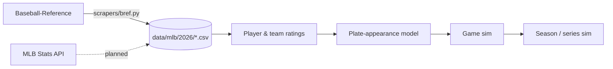

# Sports Sim

A game simulator for different sports, driven by real player and team data. **MLB comes first**; other sports will be added later under the same package.

## Status

| Area | Status |
|---|---|
| MLB data: Baseball-Reference scraper | ✅ Working (team + player season stats, 40-man rosters) |
| MLB data: MLB Stats API (live rosters) | ⏳ Planned |
| MLB sim engine (plate appearance → game) | ⏳ Planned |
| Season / series simulation | ⏳ Planned |
| Other sports | 💭 Later |

See [docs/ROADMAP.md](docs/ROADMAP.md) for the full plan.

## How it fits together



More detail in [docs/ARCHITECTURE.md](docs/ARCHITECTURE.md).

## Setup

```bash
git clone https://github.com/mhutch14/sports-sim.git
cd sports-sim
python -m venv .venv
source .venv/bin/activate          # Windows: .venv\Scripts\activate
pip install -e ".[dev]"
```

## Get the data

```bash
python -m sportsim.mlb.scrapers.bref              # 2026 season, ~2 minutes
python -m sportsim.mlb.scrapers.bref --rosters    # + 40-man rosters
```

The CSVs go to `data/mlb/<season>/`. Data is **not committed to git**; each machine scrapes its own copy (see [docs/DATA_SOURCES.md](docs/DATA_SOURCES.md) for why and for the site's rate limits).

## Run the tests

```bash
pytest
```

Tests also run automatically on GitHub every time you push.

## Project layout

```
sports-sim/
├── src/sportsim/          # the Python package
│   └── mlb/
│       ├── scrapers/      # data collection (bref.py)
│       └── sim/           # simulation engine (coming)
├── tests/                 # pytest tests (offline, no network)
├── data/                  # scraped data + page cache (git-ignored)
├── docs/                  # roadmap, architecture, data sources, git guide
├── .github/workflows/     # automatic tests on push
├── pyproject.toml         # package + dependencies
└── CHANGELOG.md           # what changed, by date
```

## Working on it

Day-to-day git commands are in [docs/GIT_WORKFLOW.md](docs/GIT_WORKFLOW.md).
