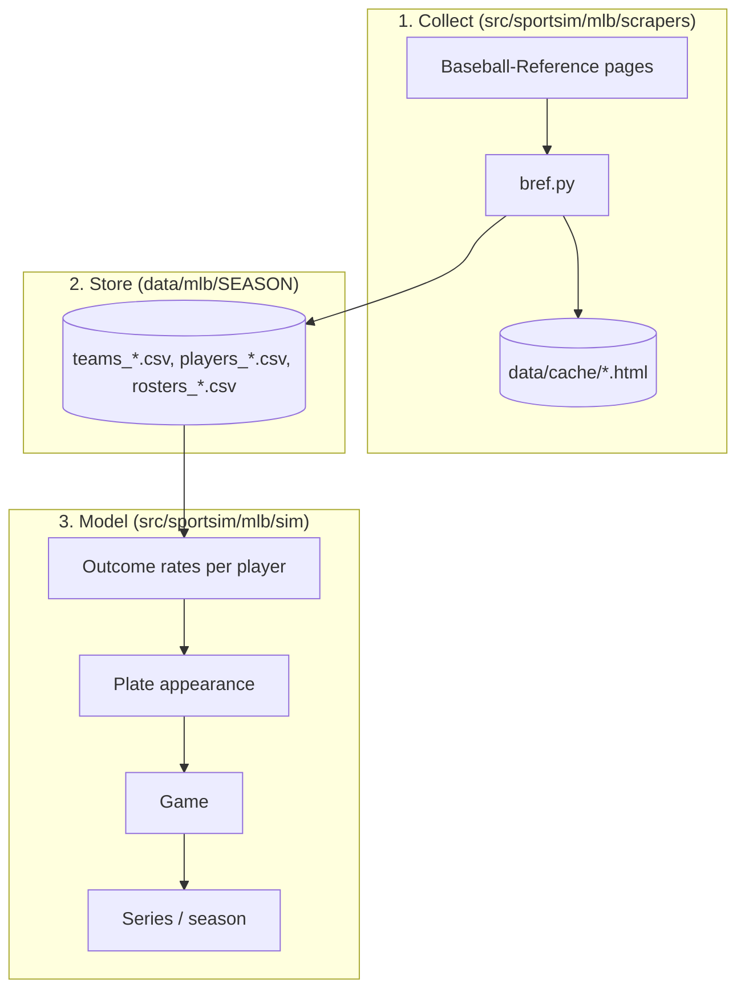

# Architecture

## Data flow



## Key ideas

| Concept | Where | Notes |
|---|---|---|
| `player_id` | every player CSV | Baseball-Reference ID (e.g. `judgeaa01`). The join key across all tables. |
| `team` | player CSVs | Baseball-Reference abbreviation (e.g. `NYY`, `ATH`). |
| Page cache | `data/cache/` | Re-running the scraper is free; use `--refresh` to re-download. |
| One package, many sports | `src/sportsim/<sport>/` | Each sport gets its own `scrapers/` and `sim/`. Shared code can go in `src/sportsim/common/` later. |

## Folder → responsibility

```
src/sportsim/
├── __init__.py
└── mlb/
    ├── scrapers/
    │   └── bref.py      fetch + parse + save CSVs
    └── sim/             (empty) game engine goes here
```
