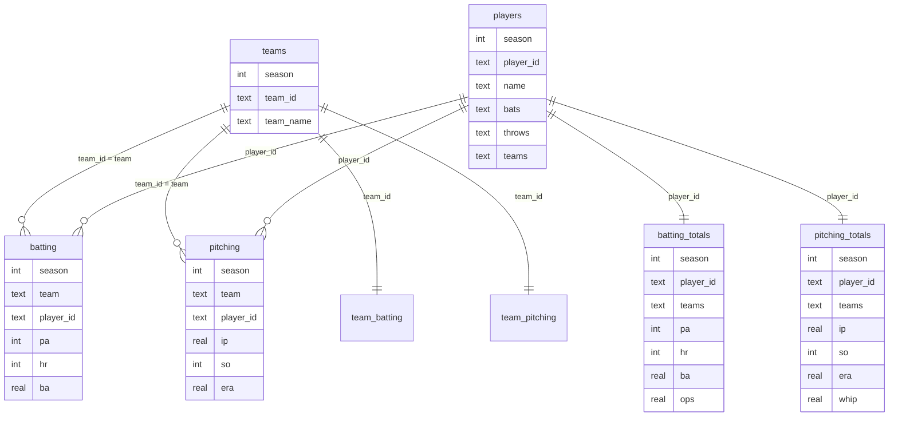

# Database

SQLite: free, a single file (`data/sportsim.db`), built into Python. No server to install.

## Build it

```bash
python -m sportsim.mlb.scrapers.bref     # 1. scrape → data/mlb/2026/*.csv
python -m sportsim.mlb.db build          # 2. load every season found → data/sportsim.db
python -m sportsim.mlb.db tables         # 3. check row counts
```

Re-running `build` replaces that season's rows. It never duplicates them. Scrape another year (`--season 2025`) and build again, and both seasons sit side by side.

## How the tables connect



Every table has `season`. Always join on **`season` + `player_id`** (or `season` + `team`).

## `batting` vs `batting_totals`

A player traded mid-season has one row **per team** in `batting`, and one combined row in `batting_totals`:

**Before: `batting`** (per team)

| team | name | ab | h | hr | ba |
|---|---|---|---|---|---|
| NYY | Traded Guy | 200 | 50 | 5 | .250 |
| BOS | Traded Guy | 250 | 75 | 10 | .300 |

**After: `batting_totals`** (per season)

| teams | name | ab | h | hr | ba |
|---|---|---|---|---|---|
| NYY/BOS | Traded Guy | 450 | 125 | 15 | **.278** |

Counting stats are added; rate stats (BA, OBP, SLG, OPS, ERA, WHIP, K/9…) are **recomputed** from the totals, not averaged (averaging .250 and .300 would wrongly give .275).

Pitcher innings are handled as outs, so `60.1 + 30.2 = 91.0`, not `90.3`.

| Use… | When you want… |
|---|---|
| `batting` / `pitching` | what a player did **for a specific team** (team-level sims, rosters) |
| `batting_totals` / `pitching_totals` | a player's **whole season** (player ratings) |

## Handedness

Baseball-Reference marks names: `Name*` = left, `Name#` = switch, no mark = right. The loader strips the mark and stores it:

| Raw name | Table | → name | → column |
|---|---|---|---|
| `Juan Soto*` | batting | `Juan Soto` | `bats = L` |
| `Name#` | batting | `Name` | `bats = S` |
| `Chris Sale*` | pitching | `Chris Sale` | `throws = L` |

## Column names

Headers are cleaned so they're easy to type in SQL:

| Baseball-Reference | Column |
|---|---|
| `Player` | `name` |
| `2B`, `3B` | `doubles`, `triples` |
| `OPS+`, `ERA+` | `ops_plus`, `era_plus` |
| `W-L%` | `win_pct` |
| `SO/W`, `SO/BB` | `so_per_bb` |
| `HR`, `SO9`, `WHIP` | `hr`, `so9`, `whip` |

## Example queries

```bash
# Top 10 HR hitters
python -m sportsim.mlb.db query "SELECT name, teams, hr, ops FROM batting_totals WHERE season=2026 ORDER BY hr DESC LIMIT 10"

# Qualified starters by ERA (162+ IP)
python -m sportsim.mlb.db query "SELECT name, teams, ip, era, whip, so9 FROM pitching_totals WHERE season=2026 AND ip >= 162 ORDER BY era LIMIT 10"

# A team's lineup
python -m sportsim.mlb.db query "SELECT name, pos, pa, ba, obp, slg FROM batting WHERE season=2026 AND team='NYY' ORDER BY pa DESC"

# Left-handed relievers
python -m sportsim.mlb.db query "SELECT p.name, p.teams, t.g, t.so9, t.era FROM players p JOIN pitching_totals t USING (season, player_id) WHERE p.throws='L' AND t.gs = 0 AND t.g >= 30"
```

From Python (e.g. in the sim code):

```python
from sportsim.mlb import db

hitters = db.query("SELECT * FROM batting_totals WHERE season = ? AND pa >= ?", (2026, 100))
```

Any SQLite viewer (e.g. **DB Browser for SQLite**, free) can also open `data/sportsim.db` to browse the tables.
