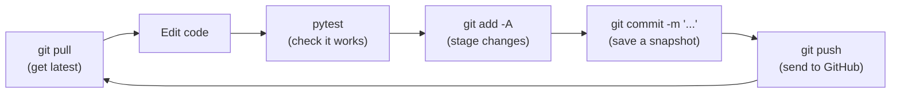

# Git workflow cheat sheet

## The everyday loop



```bash
git pull                              # 1. start every session with this
# ...work...
pytest                                # 2. make sure nothing broke
git status                            # 3. see what changed
git add -A                            # 4. stage everything
git commit -m "Add MLB Stats API roster client"   # 5. snapshot with a clear message
git push                              # 6. upload
```

## Where your changes live

| Command | Moves changes from → to |
|---|---|
| `git add` | your files → staging area |
| `git commit` | staging area → your local history |
| `git push` | local history → GitHub |
| `git pull` | GitHub → local history + your files |

## Trying something risky? Use a branch

```bash
git switch -c sim-engine          # new branch
# ...work, commit as usual...
git push -u origin sim-engine     # first push of the branch
# when happy: open a Pull Request on GitHub and merge it into main
git switch main && git pull       # back to main with the merged work
```

## Commit message examples

| Good | Not so good |
|---|---|
| `Add handedness splits to bref scraper` | `stuff` |
| `Fix traded players counted twice` | `fixed it` |
| `Docs: explain park factors` | `update` |

## Oops fixes

| Problem | Fix |
|---|---|
| Undo changes to a file you haven't committed | `git restore path/to/file` |
| Unstage a file | `git restore --staged path/to/file` |
| Fix the last commit message (not pushed yet) | `git commit --amend -m "better message"` |
| `git push` rejected (remote has new commits) | `git pull` then `git push` |
| See recent history | `git log --oneline -10` |

## Before each push, remember
- Update `CHANGELOG.md` if you finished something.
- Tick off items in `docs/ROADMAP.md`.
- Never commit anything in `data/` or a `.env` file (already in `.gitignore`).
