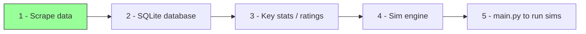

# Roadmap

## Phase 1: Data ✅ in progress
- [x] Baseball-Reference scraper: team + player season stats
- [x] 40-man rosters (`--rosters`)
- [ ] MLB Stats API client for live rosters / depth charts / transactions
- [ ] Combine traded players' rows by `player_id`
- [ ] Handedness (L/R) splits for hitters and pitchers

## Phase 2: Database (SQLite, free and built into Python)
- [ ] Load the scraped CSVs into `data/sportsim.db` (tables: teams, players, batting, pitching, rosters)
- [ ] `player_id` / `team` as keys so tables join cleanly
- [ ] One command to rebuild the database after each scrape

## Phase 3: Which stats matter (ratings)
- [ ] Turn season stats into per-plate-appearance outcome rates (K, BB, HBP, 1B, 2B, 3B, HR, out)
- [ ] Regress small samples toward league average
- [ ] Park factors

## Phase 4: Simulation engine
- [ ] Batter-vs-pitcher matchup model (e.g. log5 / odds-ratio)
- [ ] Base-running & out logic, innings, extras
- [ ] Lineups and starting pitcher / bullpen usage
- [ ] Box score output

- [ ] Monte Carlo: run a matchup N times → win probability, score distribution
- [ ] Full schedule → standings projections

## Phase 5: `main.py` to run simulations
- [ ] e.g. `python main.py --home NYY --away BOS --games 1000`
- [ ] Print box score / win probability summary

## Later: Other sports
- [ ] Reuse the same layout: `sportsim/<sport>/scrapers`, `sportsim/<sport>/sim`
