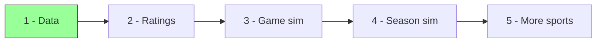

# Roadmap

## Phase 1: Data ✅ in progress
- [x] Baseball-Reference scraper: team + player season stats
- [x] 40-man rosters (`--rosters`)
- [ ] MLB Stats API client for live rosters / depth charts / transactions
- [ ] Combine traded players' rows by `player_id`
- [ ] Handedness (L/R) splits for hitters and pitchers

## Phase 2: Player & team ratings
- [ ] Turn season stats into per-plate-appearance outcome rates (K, BB, HBP, 1B, 2B, 3B, HR, out)
- [ ] Regress small samples toward league average
- [ ] Park factors

## Phase 3: Single-game simulation
- [ ] Batter-vs-pitcher matchup model (e.g. log5 / odds-ratio)
- [ ] Base-running & out logic, innings, extras
- [ ] Lineups and starting pitcher / bullpen usage
- [ ] Box score output

## Phase 4: Series & season simulation
- [ ] Monte Carlo: run a matchup N times → win probability, score distribution
- [ ] Full schedule → standings projections

## Phase 5: Other sports
- [ ] Reuse the same layout: `sportsim/<sport>/scrapers`, `sportsim/<sport>/sim`
